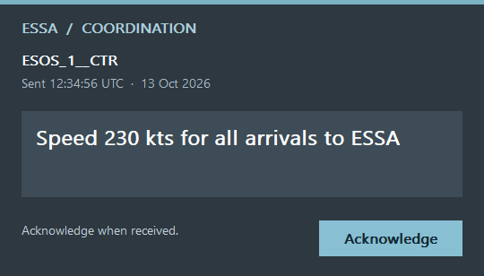

# SAAMAN

An embedded EuroScope arrival manager for Stockholm Arlanda (ESSA), with shared
sequencing and controller coordination through the existing vatIRIS backend.
The current version is **1.3.13**. Live feeder and landing forecasts use the bundled 398-aircraft descent, approach and landing reference database when route and telemetry are usable, with fallback for incomplete inputs. Syncing between two EuroScope controllers has
been confirmed in use.

**Shared mode requires the vatIRIS AMAN backend**, normally at
`https://backend.vatiris.se`. Controllers do not need to install the vatIRIS app
or log in to it separately. Local EuroScope mode works without that backend and
does not share changes with other controllers.
Fresh settings default to shared vatIRIS mode on VATSIM live. Explicitly saved
local mode or a training network is remembered. SAAMAN connects in the background
as soon as the plugin is loaded on a radar screen and EuroScope has logged in;
the pane can stay closed.

Read the [controller user guide](docs/user-guide.md). An [offline HTML version](docs/user-guide.html)
and [wiki-ready HTML](docs/user-guide-wiki.html) are included, with
[publication instructions](docs/WIKI-UPLOAD.md) for the Scandinavia wiki.

## Download and install

Download the ZIP from [Releases](https://github.com/Kaskobiii/SAAMAN/releases).
Unload the previous plugin before replacing and loading `SAAMAN.dll`. Microsoft
Edge WebView2 Runtime is required. No EuroScope profile changes are needed.

Use `.saaman` to open AMAN and `.saaman supervisor` for supervision. To change
the saved connection, select
**MAESTRO > Operation mode > Shared backend > vatIRIS EuroScope callsign**,
use `https://backend.vatiris.se`, and choose VATSIM live, SweatBox 1 or SweatBox 2.
Controllers on the same network share one ESSA sequence. No separate AMAN login
or controller key is required in vatIRIS callsign mode.

## Features

- Shared sequence, edits and acknowledgements, with one elected sequencer and
  recovery when another controller takes over.
- Initial runway configuration from EuroScope's active ARR/DEP selections.
- Sync EuroScope in runway configuration reapplies the current ARR/DEP selections.
- Submenus and dialogs can be moved outside AMAN on the EuroScope radar.
- Live landing ETA to the assigned runway threshold, using remaining route
  distance and expected slowing down, with position-based timing on short final.
  Feeder estimates keep their normal/near-fix allowance. Existing accepted times,
  instructions and order remain protected; Recompute captures fresh planning time.
  Earlier predictions remain uncertain during vectors or before clearance changes;
  see the replay results and limitations in the release notes.
- Controller-specific ACC/ARR-W feeder coverage, with unfiltered Runway and FLOW views.
- Coordination notifications in a separate window centered over EuroScope,
  showing the sending login callsign and UTC send time.
- Local mode, session recording, supervision and TopSky guidance output.

## Development

Editable TypeScript/Vue UI and calculation code are in `source/ui`; the x86
Win32/WebView2 plugin is in `source/native`. Build scripts, model/adapter tests
and native test harnesses are included. See [BUILDING.md](BUILDING.md).

[Backend compatibility tests](docs/BACKEND-COMPATIBILITY.md) use the actual public
vatIRIS router on an isolated loopback server. GitHub Actions checks both a pinned
backend commit and current upstream main when a pull request or main update runs.

The 1.3.4 baseline passed 272 model/adapter tests, UI type checks, the Win32 build,
native state checks and real renderer/popup checks. The native fixtures cover
FMP, handover, receiver and APP-W views. The existing drag-trail correction has
also been confirmed in EuroScope.

See [architecture](source/ARCHITECTURE.md),
[backend integration](source/BACKEND-INTEGRATION.md),
[operating requirements](source/OPERATING-REQUIREMENTS.md) and
[latest release notes](docs/RELEASE-NOTES-1.3.13.md).

## License and credits

SAAMAN includes GPLv3-derived vatIRIS work and is distributed under the
[GNU GPL v3](LICENSE.txt). Dependency licenses and attribution are retained in
[THIRD-PARTY-NOTICES.txt](THIRD-PARTY-NOTICES.txt) and the source tree.
