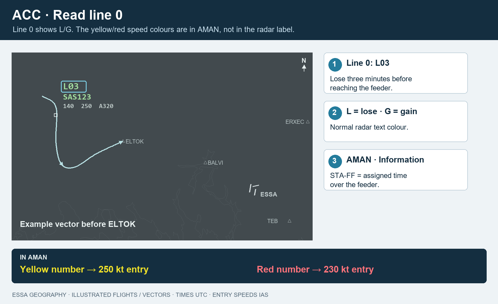
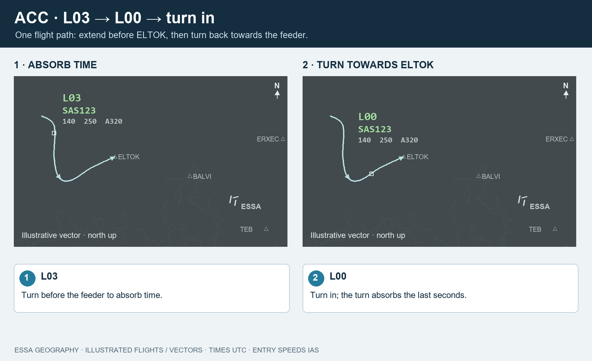
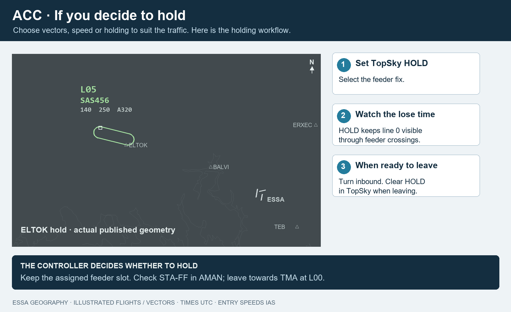
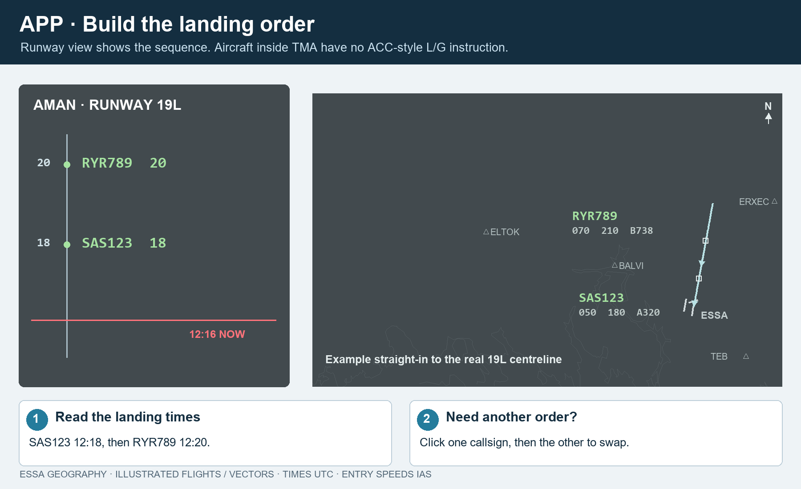

# SAAMAN: ACC and APP quick guide

**ACC delivers the feeder order. APP builds the landing order. All times are UTC.**

## 1. Start here

1. Load the current DLL in every EuroScope instance. Put SAAMAN above TopSky in the plugin list.
2. Select ESSA **ARR and DEP** in EuroScope. In AMAN, press **Sync EuroScope** and check the header.
3. Check **LIVE** above the clock. Shared updates continue with the AMAN window closed.

ESSA_E_APP is sequencer first, then ESSA_FMP. This priority is enforced by the updated backend for every client. ESOS/ESAA CTR, ESSA APP and ESSA_FMP connect automatically; other positions connect manually. TWR is view-only.

## 2. ACC: read the label

**Line 0: L03** means lose three minutes before entry. **G** means time to gain. Find the assigned feeder time in **AMAN → Information → STA-FF**.

**In AMAN: yellow number → 250 kt entry; red number → 230 kt entry.** These are IAS, not groundspeed. Line 0 does not use these colours.

## 3. ACC: L03 → L00 → turn in

1. **L03:** turn the aircraft before the feeder to absorb time.
2. **L00:** turn towards the feeder. The turn absorbs the remaining seconds. AMAN itself leaves the zero-minute number blank.
3. Deliver the aircraft at its assigned feeder time and entry speed.

Use **ACC** for the feeders you cover. ESSA_W_APP uses **ARR-W** for ELTOK. **AMAN suggests a sequence; the final decision is yours.** To swap your feeder order, **click one aircraft, then the other**. Their assigned times and lose/gain instructions update to match the new order. AMAN gives aircraft separate feeder slots.

## 4. ACC: if you decide to hold

**You decide** whether to use speed, vectors or holding. L05 is an example, not a threshold requiring a hold.

1. **Set HOLD in TopSky** at the feeder and put the aircraft into the hold.
2. **Watch the lose time reduce.** The holding flag keeps line 0 visible when it crosses the feeder while holding.
3. **At L00, leave the hold towards TMA.** Clear HOLD in TopSky when leaving and aim for the assigned feeder time.

Leave the assigned slot alone while flying the hold. Use **STA-FF and NOW** to check when it should cross inbound.

## 5. APP: build the landing sequence

1. Select **Runway**. Read the landing order and assigned times.
2. Use your normal speeds and vectors to build that order on final.
3. **Click two aircraft to swap.** Select and drag an aircraft to insert it elsewhere; follow the insertion arrow.

Inside TMA, use the assigned times: **there are no ACC-style L/G instructions**. Runway spacing still applies. Runway and FLOW are visible to everyone; ACC/ARR-W filters only the feeders you cover.

## 6. Only the buttons you need

| When… | Do this |
|---|---|
| You give a meaningful direct or approach change | **Recompute** to accept a new estimate. Do not use repeated Recompute to count down a hold. |
| An aircraft goes around | **Missed Approach → aircraft → Reinsert on → TEB, BALVI, ERXEC or OBCIV.** |
| You need exact times | **Aircraft → Information.** |
| An aircraft has no flight plan | **MAESTRO → Insert flight.** |
| Something looks wrong | Check **Information**, **Errors**, the runway and the sequencer-version warning. |

Pictures use ESSA fix/runway positions and the installed ESAA sector coastline and ELTOK holding geometry. Aircraft, times and vector paths are illustrative.
